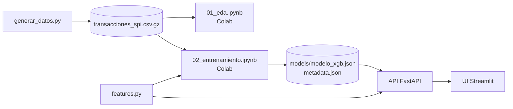

# 🛡️ Detector de anomalías en transferencias SPI

**Proyecto 12 — Sector 4: Economía, Finanzas y Comercio Local**
Luz Mereles · Sol Nuñez

Sistema de punta a punta (*end-to-end ML system*) que recibe una transferencia del **SPI (Sistema de Pagos
Instantáneos)**, vista desde el **banco emisor**, y responde **en milisegundos** con un **RiskScore (0–100)** y la
decisión **APROBAR / REVISAR / BLOQUEAR**, explicando los motivos con valores SHAP.

## Contexto

Las transferencias instantáneas del SPI tuvieron una adopción masiva en Paraguay. Con ellas crecieron la toma de
cuentas por phishing, las ráfagas de transferencias, el uso de cuentas mula y las estafas por WhatsApp o Marketplace.
El desafío técnico es que el fraude representa **menos del 0,1 %** de las transferencias: un modelo que diga siempre
"legítima" tiene 99,9 % de *accuracy* y no sirve para nada.

**Alcance:** solo la instrucción de transferencia interbancaria del SPI. No se distingue el canal de iniciación
(app, web o PY-QR). Todas las variables son información que el banco emisor conoce al autorizar la transferencia.
Las variables de **comportamiento** del cliente (historial reciente, destinatario y dispositivo nuevos) **no las
calcula la API**: se supone que las provee ya calculadas el sistema del banco (core bancario o un *feature store*).
Ver [Qué recibe la API](#qué-recibe-la-api-una-transferencia-enriquecida).

## Estructura

```
detector-sip/
├── generar_datos.py            genera el dataset sintético y exporta los CSV
├── features.py                 esquema, partición temporal y las 14 features (lo usan generar_datos.py, los notebooks y la API)
├── data/
│   ├── transacciones_spi.csv.gz      dataset completo (jul 2025 – jun 2026)
│   ├── muestra_transacciones.csv     5.000 filas para inspeccionar en Excel
│   ├── demo/flujo_demo.csv           transferencias del período de prueba para el simulador de la demo
│   └── DATASET.md                    documentación del dataset (data card)
├── notebooks/                  se ejecutan en Google Colab
│   ├── 01_eda.ipynb                  análisis exploratorio -> reports/eda/
│   └── 02_entrenamiento.ipynb        entrena, evalúa y exporta el modelo -> models/ y reports/
├── models/                     modelo_xgb.json + metadata.json + verificacion_features.csv (exportados por el notebook 02)
├── reports/                    gráficos, tablas y RESULTADOS.md (exportados por los notebooks)
├── api/                        FastAPI: schemas, motor de riesgo, rutas, Dockerfile
├── ui/                         Streamlit + Dockerfile
├── tests/                      pruebas de la API (pytest)
├── docs/DEFENSA.md             guía de estudio para la defensa
├── requirements.txt            dependencias para trabajar en la PC
├── requirements-colab.txt      lo que falta instalar en Colab (optuna)
└── docker-compose.yml
```



## ☁️ Paso a paso en Google Colab

1. Subí la carpeta `detector-sip` completa a **Mi unidad** de Google Drive (queda en
   `/content/drive/MyDrive/detector-sip`; si la ponés en otro lugar, cambiá `CARPETA_EN_DRIVE` en la primera
   celda de cada notebook).
2. En Drive, clic derecho sobre `notebooks/01_eda.ipynb` → **Abrir con → Google Colaboratory** →
   *Entorno de ejecución → Ejecutar todas*. Colab pide permiso para acceder a Drive: es para leer el CSV y guardar
   los resultados en la misma carpeta.
3. Lo mismo con `notebooks/02_entrenamiento.ipynb` (≈ 10–25 minutos). Al terminar quedan actualizados
   `models/modelo_xgb.json`, `models/metadata.json` y `reports/`.
4. Descargá la carpeta (o al menos `models/` y `reports/`) a tu PC para usar ese modelo en la API.

**En la PC (Jupyter o VS Code)** funcionan igual: la primera celda detecta que no está en Colab y usa la carpeta del
proyecto (`jupyter notebook notebooks/01_eda.ipynb`, con el entorno de `requirements.txt`).

Los notebooks guardan sus cambios en la misma carpeta de Drive. Los entregados ya están ejecutados: lo que se ve es
la corrida de verificación que produjo los resultados de este README; al ejecutarlos en Colab se reemplazan por los tuyos.

## Dataset sintético

`python generar_datos.py` (unos minutos, semilla fija 42). Detalle en [`data/DATASET.md`](data/DATASET.md).

| | |
|---|---|
| Período | 1/7/2025 – 30/6/2026 (junio 2025 se simula solo como historial previo) |
| Transferencias / fraudes | 1.692.473 / 1.331 (0,079 %), en 505 casos de fraude |
| Clientes emisores | 8.000 (80 % regulares, 10 % nuevos que abren la cuenta en el año, 10 % esporádicos) |
| Salario mínimo de referencia | Gs. 3.044.000 (para generar capacidad económica variada, no como tope) |
| Límite por transferencia | Gs. 10.000.000 |
| Tipologías (% de casos) | toma de cuenta 40 % · ráfaga (fraccionamiento) 15 % · cuenta mula 20 % · ingeniería social 15 % · camuflado 10 % |
| Ruido legítimo | 24 % destinatario nuevo · 5 % viajes · 1,8 % dispositivo nuevo · 1,8 % madrugada |
| Diciembre | aguinaldo: más movimiento y montos 25 % más altos (cae en el entrenamiento) |
| Sin historial | `monto_promedio_30d_gs = 0` y `sin_historial = 1` (no hay valores faltantes) |

## Features del modelo

Exactamente estas 14, en este orden (`features.py`):

| Feature | Regla de derivación |
|---|---|
| `log_monto` | ln(1 + `monto_gs`) |
| `log_ratio_monto_promedio` | ln(`monto_gs` / `monto_promedio_30d_gs`); 0 cuando no hay historial |
| `sin_historial` | 1 si `monto_promedio_30d_gs` = 0 |
| `hora` | hora local (0–23) |
| `es_nocturna` | 1 si la hora es < 6 |
| `dia_semana` | 0 = lunes … 6 = domingo |
| `es_fin_de_semana` | 1 si es sábado o domingo |
| `es_fin_de_mes` | 1 si el día está entre los últimos 5 del mes |
| `log_antiguedad_origen` | ln(1 + `antiguedad_cuenta_origen_dias`) |
| `n_tx_1h`, `n_tx_24h` | transferencias **anteriores** del emisor en la última hora / 24 h |
| `destinatario_nuevo` | 1 si el emisor nunca antes le transfirió a esa cuenta |
| `dispositivo_nuevo` | 1 si el dispositivo se usó por primera vez hace ≤ 24 h |
| `ciudad_distinta` | 1 si `ciudad` ≠ `ciudad_habitual` |

IDs, bancos, `dispositivo_id`, `timestamp` sin transformar, `es_fraude` y `tipo_fraude` **no** son entradas del modelo.

`features.py` solo **transforma** las columnas que recibe (logaritmos, ratio contra el promedio, hora, calendario,
ciudad distinta). Las columnas de comportamiento de las que salen varias features (`n_tx_1h`, `n_tx_24h`,
`monto_promedio_30d_gs`, `destinatario_nuevo`, `dispositivo_nuevo`) necesitan el historial del cliente. En el dataset
las calcula `generar_datos.py`; en producción las tendría que proveer el banco (ver
[Qué recibe la API](#qué-recibe-la-api-una-transferencia-enriquecida)).

## Entrenamiento (notebook 02)

| Conjunto | Período | Transferencias | Fraudes |
|---|---|---|---|
| Entrenamiento | jul 2025 – feb 2026 | 1.137.643 | 939 |
| Validación | mar – abr 2026 | 275.906 | 180 |
| Prueba | may – jun 2026 | 278.924 | 212 |

| Etapa | Qué se hace | Conjunto |
|---|---|---|
| 1. Primera prueba | Regresión logística, XGBoost + SMOTE y XGBoost ponderado, sin ajustes (umbral 0,5) | Validación |
| 2. Ajuste | Solo XGBoost ponderado: hiperparámetros (Optuna, 40 pruebas, en un espacio acotado para evitar el sobreajuste) y umbral de decisión | Entrenamiento + validación |
| 3. Evaluación final | Solo el XGBoost ponderado ajustado | Prueba |

### Resultados (corrida de verificación)

**Etapa 1 — validación, sin ajustes**

| Modelo | Average precision | ROC-AUC | F1 (umbral 0,5) | Precisión | Recall |
|---|---|---|---|---|---|
| Regresión logística | 0,132 | 0,952 | 0,017 | 0,009 | 0,811 |
| XGBoost + SMOTE | 0,400 | 0,941 | 0,159 | 0,092 | 0,594 |
| XGBoost ponderado | **0,462** | 0,942 | 0,151 | 0,085 | 0,694 |

**Etapas 2 y 3 — XGBoost ponderado ajustado** (umbral = máximo F1 en validación = 0,787)

| Conjunto | Average precision | ROC-AUC | F1 | Precisión | Recall |
|---|---|---|---|---|---|
| Validación (optimista: se ajustó con ella) | 0,558 | 0,962 | 0,588 | 0,750 | 0,483 |
| **Prueba** | **0,529** (IC 95 %: 0,47 – 0,59) | **0,971** | **0,515** | **0,737** | **0,396** |

Con la **política de 3 niveles de la API** se detienen en prueba **162 de 212 fraudes** (64 bloqueados y 98 a
revisión) y el **86 % del monto defraudado**, con solo 8 transferencias legítimas bloqueadas y 0,48 % enviadas a
revisión. Detección por tipología: toma de cuenta 100 %, cuenta mula 88 %, ráfagas 74 %; ingeniería social y camuflado
no se detectan (imitan el comportamiento normal: es la limitación esperada de un detector útil pero no perfecto).
Latencia del modelo: ~2 ms por transferencia.

**Control del sobreajuste.** Optuna (40 pruebas) busca solo entre árboles chicos y regularizados: profundidad 3–5,
`min_child_weight` 10–50 y `reg_lambda` 1–50 (el resto de los rangos está en `RANGOS`, celda "Parámetros ajustables" del
notebook 02). Con unos 350 casos de fraude en entrenamiento (939 transferencias), un árbol profundo y poco regularizado puede armar hojas
hechas a medida de 1 o 2 casos; estos rangos limitan la complejidad de cada árbol para favorecer la generalización a
meses nuevos. En el modelo final, el **5,7 %** de las hojas que suben el riesgo se apoya en 1 o 2 casos de fraude de
entrenamiento, y la average precision es 0,648 en entrenamiento, 0,558 en validación y 0,529 en prueba: el sobreajuste
queda acotado, no eliminado.

Importancia (SHAP) sobre los fraudes: **dispositivo nuevo** primero, luego la información horaria, transferencias en la
última hora, destinatario nuevo y monto. Ninguna feature decide sola: el mismo caso de cuenta mula pasa de REVISAR a
APROBAR si se quita el dispositivo nuevo.

Detalle completo: [`reports/RESULTADOS.md`](reports/RESULTADOS.md),
[`reports/classification_reports.txt`](reports/classification_reports.txt) y [`reports/figures/`](reports/figures/).

## 🔧 Cómo ajustar y reentrenar

Cada pieza se puede cambiar sin romper las demás, porque se comunican por archivos con formato fijo:

| Quiero cambiar… | Dónde | Después |
|---|---|---|
| Hiperparámetros base, SMOTE, cantidad de pruebas y rangos de búsqueda de Optuna (`RANGOS`), política de bloqueo/revisión | celda **Parámetros ajustables** de `02_entrenamiento.ipynb` | ejecutar todo el notebook 02 |
| El dataset (clientes, tasa de fraude, semilla) | `python generar_datos.py --clientes 8000 --tasa-fraude 0.0008 --seed 42` | notebooks 01 y 02 |
| Proporción de tipologías o ruido legítimo | constantes al inicio de `generar_datos.py` (`TIPOLOGIAS`, `P_CLIENTES_NUEVOS`, `P_VIAJE`, …) | notebooks 01 y 02 |
| Las features | `features.py` (lo usan el notebook y la API) | notebook 02; los tests verifican que coincidan |

El notebook 02 vuelve a escribir `models/modelo_xgb.json`, `models/metadata.json` (con los **umbrales** de la API),
`models/verificacion_features.csv` y `reports/`. La API lee todo de `models/` al arrancar: **no hay que tocar código**,
solo reiniciarla (`docker compose up --build` copia el modelo nuevo a la imagen). Si se reentrena en Colab, copiar
`models/` y `reports/` desde Drive a la carpeta local antes de levantar Docker. Para volver al modelo entregado, basta
con restaurar esas dos carpetas desde el ZIP.

##  Levantar la API y la interfaz con Docker

```bash
docker compose up --build
```

| Servicio | URL |
|---|---|
| Interfaz (Streamlit) | http://localhost:8501 |
| API — documentación Swagger | http://localhost:8000/docs |

Usa el modelo que está en `models/`. Si entrenaste en Colab, copiá antes tu `models/` y `reports/` a esta carpeta.

##  Ejecución local (sin Docker)

Requiere Python 3.11 o superior.

```bash
python -m venv .venv
# Windows: .venv\Scripts\activate      Linux/Mac: source .venv/bin/activate
pip install -r requirements.txt

python generar_datos.py              # 1. datos (el ZIP ya los trae)
# 2. EDA y entrenamiento: notebooks/01_eda.ipynb y 02_entrenamiento.ipynb (Colab o Jupyter)
uvicorn api.main:app --port 8000     # 3. API      (terminal 1)
streamlit run ui/app.py              #    interfaz (terminal 2)
pytest                               # 4. pruebas
```

## API

| Método | Ruta | Descripción |
|---|---|---|
| `POST` | `/score` | Evalúa una transferencia |
| `POST` | `/score/batch` | Evalúa hasta 1.000 transferencias |
| `GET` | `/health` | Estado del servicio |
| `GET` | `/model/info` | Versión, métricas, umbrales e hiperparámetros |
| `GET` | `/stats` | Decisiones tomadas y latencia (media y p95) desde el arranque |

La entrada usa el **mismo esquema que el dataset** (sin `es_fraude` ni `tipo_fraude`); los identificadores y bancos
son opcionales y el modelo no los usa. Ejemplo:

```bash
curl -X POST http://localhost:8000/score -H "Content-Type: application/json" -d '{
  "timestamp": "2026-05-20T03:14:00", "monto_gs": 4500000,
  "ciudad": "Ciudad del Este", "ciudad_habitual": "Asunción",
  "antiguedad_cuenta_origen_dias": 1450, "monto_promedio_30d_gs": 380000,
  "n_tx_1h": 2, "n_tx_24h": 3, "destinatario_nuevo": true, "dispositivo_nuevo": true }'
```

Los datos inválidos (monto ≤ 0, **monto mayor a Gs. 10.000.000**, campos faltantes, `n_tx_24h < n_tx_1h`, etc.)
devuelven **422** con el detalle de cada error. **Motor híbrido**: una regla de negocio sube a REVISAR las ráfagas de
10 o más transferencias en una hora.

### Qué recibe la API: una transferencia enriquecida

La API es **sin estado**: evalúa cada transferencia por separado, no guarda las transferencias que recibe y no tiene
acceso al historial de los clientes asumiendo que sera provisto por el sistema de datos del banco por eso **no calcula el comportamiento del cliente**: lo recibe ya calculado,
junto con los datos de la transferencia (una transferencia "enriquecida"). Con esa entrada solo aplica las
transformaciones de `features.py`, predice y explica.

| Campo de entrada | Qué es | Quién lo provee en producción | Definición que tiene que respetar (la del entrenamiento) |
|---|---|---|---|
| `timestamp`, `monto_gs`, `ciudad` | Datos de la transferencia | Canal digital (app / web) | Hora local de Paraguay; ciudad desde donde se opera |
| `ciudad_habitual` | Perfil del cliente | Core bancario | Ciudad habitual del cliente |
| `antiguedad_cuenta_origen_dias` | Perfil del cliente | Core bancario | Días desde la apertura de la cuenta del emisor |
| `n_tx_1h`, `n_tx_24h` | Comportamiento | *Feature store* en tiempo real | Transferencias **anteriores** del emisor en `[t − 1 h, t)` y `[t − 24 h, t)`, sin contar la actual |
| `monto_promedio_30d_gs` | Comportamiento | *Feature store* | Promedio de los montos anteriores del emisor en `[t − 30 días, t)`; 0 o `null` si no hay ninguno |
| `destinatario_nuevo` | Comportamiento | Core bancario o *feature store* | Verdadero solo si el emisor **nunca antes** le transfirió a esa cuenta |
| `dispositivo_nuevo` | Comportamiento | Registro de dispositivos del canal digital | Verdadero si el emisor usó ese dispositivo por primera vez|


En este proyecto variables de comportamiento llegan ya calculadas:

- al entrenar, desde `generar_datos.py` (función `_calcular_contexto`, solo con transferencias anteriores; el
  notebook 01 lo verifica recalculándolas);
- en la demo, desde `data/demo/flujo_demo.csv` (simulador) o cargadas a mano en el formulario de la interfaz.

### Limitaciones de este diseño

- **La API confía en lo que recibe.** Valida tipos, rangos y la coherencia `n_tx_24h ≥ n_tx_1h`, pero no puede
  comprobar que `destinatario_nuevo`, `dispositivo_nuevo` o los conteos sean ciertos. Un error o una manipulación en
  el sistema que los provee cambia el score.
- **Riesgo de *training-serving skew*.** Si el banco calcula estas variables con otra definición (por ejemplo,
  contando la transferencia actual en `n_tx_1h`, con otra ventana de tiempo u otro criterio de "dispositivo nuevo"),
  el modelo recibe datos distintos a los del entrenamiento y su rendimiento puede caer sin aviso. El test
  `test_features_iguales_al_notebook` solo cubre las transformaciones de `features.py`, no el cálculo de estas
  variables.
- **Valores por defecto.** Si no se envían, `n_tx_1h` y `n_tx_24h` valen 0 y `monto_promedio_30d_gs` se toma como
  "sin historial". Para la API eso es un cliente sin actividad reciente, lo que puede bajar el riesgo de una ráfaga:
  el sistema que llama tiene que distinguir "sin historial" de "historial no disponible".


## Archivos CSV

| Archivo | Finalidad | Lo genera |
|---|---|---|
| `data/transacciones_spi.csv.gz` | dataset completo para el EDA y el entrenamiento (≈ 56 MB; pandas lo lee directo) | `generar_datos.py` |
| `data/muestra_transacciones.csv` | 5.000 filas para inspeccionar en Excel | `generar_datos.py` |
| `data/demo/flujo_demo.csv` | simulador de la demo: todos los fraudes del período de prueba + 2.500 legítimas | `generar_datos.py` |
| `reports/eda/*.csv` | calidad por columna, restricciones y features por clase | notebook 01 |
| `reports/comparacion_modelos.csv` | métricas de las tres etapas | notebook 02 |
| `reports/optuna_historial.csv` | las 40 pruebas de Optuna con sus hiperparámetros | notebook 02 |
| `models/verificacion_features.csv` | 50 transferencias con sus features: un test verifica que la API las calcula igual | notebook 02 |