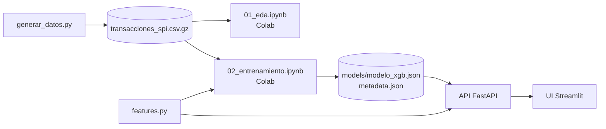

# Detector de anomalías en transferencias SPI

**Proyecto 12 — Sector 4: Economía, Finanzas y Comercio Local**
Luz Mereles · Sol Nuñez

Sistema de punta a punta (*end-to-end ML system*) que recibe una transferencia del **SPI (Sistema de Pagos
Instantáneos)**, vista desde el **banco emisor**, y responde **en milisegundos** con un **RiskScore (0–100)** y la
decisión **APROBAR / REVISAR / BLOQUEAR**, explicando los motivos con valores SHAP.

## Contexto

Las transferencias instantáneas del SPI tuvieron una adopción masiva en Paraguay. Con ellas crecieron la toma de
cuentas por phishing, las ráfagas de transferencias, el uso de cuentas mula y las estafas por WhatsApp o Marketplace.
El desafío técnico es que el fraude representa **menos del 0,1 %** de las transferencias: un modelo que diga siempre
"legítima" tiene 99,9 % de *accuracy* y no sirve para nada.

**Alcance:** solo la instrucción de transferencia interbancaria del SPI. No se distingue el canal de iniciación
(app, web o PY-QR). Todas las variables son información que el banco emisor conoce al autorizar la transferencia.

## Estructura

```
sipap-fraud-detector/
├── generar_datos.py            genera el dataset sintético y exporta los CSV
├── features.py                 esquema, partición temporal y las 14 features (lo usan los notebooks y la API)
├── data/
│   ├── transacciones_spi.csv.gz      dataset completo (jul 2025 – jun 2026)
│   ├── muestra_transacciones.csv     5.000 filas para inspeccionar en Excel
│   ├── demo/flujo_demo.csv           transferencias del período de prueba para el simulador de la demo
│   └── DATASET.md                    documentación del dataset (data card)
├── notebooks/                  se ejecutan en Google Colab
│   ├── 01_eda.ipynb                  análisis exploratorio -> reports/eda/
│   └── 02_entrenamiento.ipynb        entrena, evalúa y exporta el modelo -> models/ y reports/
├── models/                     modelo_xgb.json + metadata.json (exportados por el notebook 02)
├── reports/                    gráficos, tablas y RESULTADOS.md (exportados por los notebooks)
├── api/                        FastAPI: schemas, motor de riesgo, rutas, Dockerfile
├── ui/                         Streamlit + Dockerfile
├── tests/                      pruebas de la API (pytest)
├── docs/DEFENSA.md             guía de estudio para la defensa
├── requirements.txt            dependencias para trabajar en la PC
├── requirements-colab.txt      lo que falta instalar en Colab (optuna)
└── docker-compose.yml
```



## ☁️ Paso a paso en Google Colab

1. Subí la carpeta `sipap-fraud-detector` completa a **Mi unidad** de Google Drive (queda en
   `/content/drive/MyDrive/sipap-fraud-detector`; si la ponés en otro lugar, cambiá `CARPETA_EN_DRIVE` en la primera
   celda de cada notebook).
2. En Drive, clic derecho sobre `notebooks/01_eda.ipynb` → **Abrir con → Google Colaboratory** →
   *Entorno de ejecución → Ejecutar todas*. Colab pide permiso para acceder a Drive: es para leer el CSV y guardar
   los resultados en la misma carpeta.
3. Lo mismo con `notebooks/02_entrenamiento.ipynb` (≈ 10–25 minutos). Al terminar quedan actualizados
   `models/modelo_xgb.json`, `models/metadata.json` y `reports/`.
4. Descargá la carpeta (o al menos `models/` y `reports/`) a tu PC para usar ese modelo en la API.

Los notebooks guardan sus cambios en la misma carpeta de Drive. Los entregados ya están ejecutados: lo que se ve es
la corrida de verificación que produjo los resultados de este README; al ejecutarlos en Colab se reemplazan por los tuyos.

## Dataset sintético

`python generar_datos.py` (≈ 1 minuto, semilla fija 42). Detalle en [`data/DATASET.md`](data/DATASET.md).

| | |
|---|---|
| Período | 1/7/2025 – 30/6/2026 (junio 2025 se simula solo como historial previo) |
| Transferencias / fraudes | 1.992.495 / 1.622 (0,081 %) |
| Clientes emisores | 8.000 |
| Salario mínimo de referencia | Gs. 3.044.000 (para generar capacidad económica variada, no como tope) |
| Límite por transferencia | Gs. 10.000.000 |
| Tipologías (% de casos) | toma de cuenta 32 % · ráfaga 25 % · cuenta mula 20 % · ingeniería social 12 % · camuflado 10 % |
| Ruido legítimo | 13 % destinatario nuevo · 1 % dispositivo nuevo · 5 % viajes · 2 % actividad nocturna |
| Diciembre | aguinaldo: más movimiento y montos 25 % más altos (cae en el entrenamiento) |
| Sin historial | `monto_promedio_30d_gs = 0` y `sin_historial = 1` (no hay valores faltantes) |

## Features del modelo

Exactamente estas 14, en este orden (`features.py`):

| Feature | Regla de derivación |
|---|---|
| `log_monto` | ln(1 + `monto_gs`) |
| `log_ratio_monto_promedio` | ln(`monto_gs` / `monto_promedio_30d_gs`); 0 cuando no hay historial |
| `sin_historial` | 1 si `monto_promedio_30d_gs` = 0 |
| `hora` | hora local (0–23) |
| `es_nocturna` | 1 si la hora es < 6 |
| `dia_semana` | 0 = lunes … 6 = domingo |
| `es_fin_de_semana` | 1 si es sábado o domingo |
| `es_fin_de_mes` | 1 si el día está entre los últimos 5 del mes |
| `log_antiguedad_origen` | ln(1 + `antiguedad_cuenta_origen_dias`) |
| `n_tx_1h`, `n_tx_24h` | transferencias **anteriores** del emisor en la última hora / 24 h |
| `destinatario_nuevo` | 1 si el emisor nunca antes le transfirió a esa cuenta |
| `dispositivo_nuevo` | 1 si el dispositivo se usó por primera vez hace ≤ 24 h |
| `ciudad_distinta` | 1 si `ciudad` ≠ `ciudad_habitual` |

IDs, bancos, `dispositivo_id`, `timestamp` sin transformar, `es_fraude` y `tipo_fraude` **no** son entradas del modelo.

## Entrenamiento (notebook 02)

| Conjunto | Período | Transferencias | Fraudes |
|---|---|---|---|
| Entrenamiento | jul 2025 – feb 2026 | 1.352.688 | 1.087 |
| Validación | mar – abr 2026 | 319.545 | 201 |
| Prueba | may – jun 2026 | 320.262 | 334 |

| Etapa | Qué se hace | Conjunto |
|---|---|---|
| 1. Primera prueba | Regresión logística, XGBoost + SMOTE y XGBoost ponderado, sin ajustes (umbral 0,5) | Validación |
| 2. Ajuste | Solo XGBoost ponderado: hiperparámetros (Optuna, 40 pruebas) y umbral de decisión | Entrenamiento + validación |
| 3. Evaluación final | Solo el XGBoost ponderado ajustado, una única vez | Prueba |

### Resultados (corrida de verificación)

**Etapa 1 — validación, sin ajustes**

| Modelo | Average precision | ROC-AUC | F1 (umbral 0,5) | Precisión | Recall |
|---|---|---|---|---|---|
| Regresión logística | 0,187 | 0,974 | 0,016 | 0,008 | 0,871 |
| XGBoost + SMOTE | 0,375 | 0,949 | 0,143 | 0,081 | 0,597 |
| XGBoost ponderado | 0,414 | 0,958 | 0,062 | 0,032 | 0,677 |

**Etapas 2 y 3 — XGBoost ponderado ajustado** (umbral = máximo F1 en validación = 0,822)

| Conjunto | Average precision | ROC-AUC | F1 | Precisión | Recall |
|---|---|---|---|---|---|
| Validación (optimista: se ajustó con ella) | 0,538 | 0,984 | 0,571 | 0,860 | 0,428 |
| **Prueba (una sola vez)** | **0,444** (IC 95 %: 0,39 – 0,50) | **0,976** | **0,427** | **0,784** | **0,293** |

Con la **política de 3 niveles de la API** se detienen en prueba **222 de 334 fraudes** (79 bloqueados y 143 a
revisión) y el **68 % del monto defraudado**, con solo 11 transferencias legítimas bloqueadas y 0,45 % enviadas a
revisión. Detección por tipología: toma de cuenta 88 %, ráfagas 75 %, cuentas mula 36 %, ingeniería social 4 % y
camuflado 12 %. Latencia del modelo: ~2 ms por transferencia.

Detalle completo: [`reports/RESULTADOS.md`](reports/RESULTADOS.md),
[`reports/classification_reports.txt`](reports/classification_reports.txt) y [`reports/figures/`](reports/figures/).

## 🚀 Levantar la API y la interfaz con Docker

```bash
docker compose up --build
```

| Servicio | URL |
|---|---|
| Interfaz (Streamlit) | http://localhost:8501 |
| API — documentación Swagger | http://localhost:8000/docs |

Usa el modelo que está en `models/`. Si entrenaste en Colab, copiá antes tu `models/` y `reports/` a esta carpeta.

## 💻 Ejecución local (sin Docker)

Requiere Python 3.11 o superior.

```bash
python -m venv .venv
# Windows: .venv\Scripts\activate      Linux/Mac: source .venv/bin/activate
pip install -r requirements.txt

python generar_datos.py              # 1. datos (el ZIP ya los trae)
# 2. EDA y entrenamiento: notebooks/01_eda.ipynb y 02_entrenamiento.ipynb (Colab o Jupyter)
uvicorn api.main:app --port 8000     # 3. API      (terminal 1)
streamlit run ui/app.py              #    interfaz (terminal 2)
pytest                               # 4. pruebas
```

## API

| Método | Ruta | Descripción |
|---|---|---|
| `POST` | `/score` | Evalúa una transferencia |
| `POST` | `/score/batch` | Evalúa hasta 1.000 transferencias |
| `GET` | `/health` | Estado del servicio |
| `GET` | `/model/info` | Versión, métricas, umbrales e hiperparámetros |
| `GET` | `/stats` | Decisiones tomadas y latencia (media y p95) desde el arranque |

La entrada usa el **mismo esquema que el dataset** (sin `es_fraude` ni `tipo_fraude`); los identificadores y bancos
son opcionales y el modelo no los usa. Ejemplo:

```bash
curl -X POST http://localhost:8000/score -H "Content-Type: application/json" -d '{
  "timestamp": "2026-05-20T03:14:00", "monto_gs": 4500000,
  "ciudad": "Ciudad del Este", "ciudad_habitual": "Asunción",
  "antiguedad_cuenta_origen_dias": 1450, "monto_promedio_30d_gs": 380000,
  "n_tx_1h": 2, "n_tx_24h": 3, "destinatario_nuevo": true, "dispositivo_nuevo": true }'
```

Los datos inválidos (monto ≤ 0, **monto mayor a Gs. 10.000.000**, campos faltantes, `n_tx_24h < n_tx_1h`, etc.)
devuelven **422** con el detalle de cada error. **Motor híbrido**: una regla de negocio sube a REVISAR las ráfagas de
10 o más transferencias en una hora.

## Archivos CSV

| Archivo | Finalidad | Lo genera |
|---|---|---|
| `data/transacciones_spi.csv.gz` | dataset completo para el EDA y el entrenamiento (≈ 65 MB; pandas lo lee directo) | `generar_datos.py` |
| `data/muestra_transacciones.csv` | 5.000 filas para inspeccionar en Excel | `generar_datos.py` |
| `data/demo/flujo_demo.csv` | simulador de la demo: todos los fraudes del período de prueba + 2.500 legítimas | `generar_datos.py` |
| `reports/eda/*.csv` | calidad por columna, restricciones y features por clase | notebook 01 |
| `reports/comparacion_modelos.csv` | métricas de las tres etapas | notebook 02 |
| `reports/optuna_historial.csv` | las 40 pruebas de Optuna con sus hiperparámetros | notebook 02 |
| `models/verificacion_features.csv` | 50 transferencias con sus features: un test verifica que la API las calcula igual | notebook 02 |
